<div align="center">


<br/>

<picture>
  <source media="(prefers-color-scheme: dark)" srcset="docs/assets/horizontal-couleur-sur-noir.svg">
  
</picture>

<br/><br/>


<br/>


</div>

---

## Le projet

Le matin, on part la tête ailleurs, et c'est souvent là que les clés restent sur la table. Les assistants
personnels ne servent à rien à ce moment-là : il faudrait penser à leur demander quelque chose.

LIFEWISE prend le problème dans l'autre sens. Un petit boîtier (caméra et capteurs) observe le moment du
départ, un modèle vision-langage décrit ce qu'il voit, un petit modèle de langage croise cette description avec
le contexte (l'heure, l'agenda, les habitudes), et le téléphone reçoit un rappel au bon moment. Tout tourne en
local : les images ne quittent pas la maison.

Le système ne dit jamais plus que ce que la caméra a vu. Une caméra prouve seulement qu'un objet n'est pas dans
son champ ; l'alerte invite donc à vérifier, elle n'affirme pas un oubli.

Projet du module Computer Vision (BDAI3, ENSA Tétouan), encadré par le **Pr. Otman Aghzout**.

## Le scénario pilote : la sortie du domicile

L'utilisateur se prépare à partir. LIFEWISE détecte le départ (porte, mouvement), cherche les objets habituels
(téléphone, clés, portefeuille) et voit qu'il a un rendez-vous à 10 h. Le portefeuille n'est pas dans le champ :
le téléphone affiche « Pensez à vérifier votre portefeuille », avec deux choix, *rappeler dans 5 min* ou
*ignorer*. La réponse s'inscrit dans l'historique local.

## Comment ça marche

```mermaid
flowchart LR
    A([Capteurs]) --> B[Prétraitement]
    B --> C[Analyse VLM]
    C --> D[Fusion contextuelle]
    D --> E[Décision SLM]
    E --> F[Notification mobile]
    F --> G([Historique local])

    style A fill:#0A0A0B,color:#F4F4F2,stroke:#FF7A1A
    style B fill:#0A0A0B,color:#F4F4F2,stroke:#FF7A1A
    style C fill:#0A0A0B,color:#F4F4F2,stroke:#FF7A1A
    style D fill:#0A0A0B,color:#F4F4F2,stroke:#FF7A1A
    style E fill:#0A0A0B,color:#F4F4F2,stroke:#FF7A1A
    style F fill:#0A0A0B,color:#F4F4F2,stroke:#FF7A1A
    style G fill:#FF7A1A,color:#0A0A0B,stroke:#FF7A1A
```



<details>
<summary><b>Le détail de chaque étape</b></summary>

<br/>

| Étape | Ce qu'elle fait | Sous-équipe |
|:---|:---|:---|
| **Capteurs** | Caméra et capteurs de mouvement, de porte et de luminosité produisent des mesures horodatées. Les images peuvent venir du Raspberry Pi, de la caméra du téléphone ou d'une webcam. | 1 |
| **Prétraitement** | Filtrage, normalisation, sélection des images utiles, construction de l'objet « contexte ». | 2 |
| **Analyse VLM** | Un modèle vision-langage (Moondream2, LLaVA quantifié) ou un détecteur léger dit quels objets sont vus, avec leur confiance. | 3 |
| **Fusion contextuelle** | Des règles écrites croisent les objets vus, le départ détecté et l'agenda. | 4 |
| **Décision SLM** | Un petit modèle de langage (Phi, Qwen, Mistral) formule la décision et sa justification. | 4 |
| **Notification mobile** | Le téléphone affiche l'alerte et ses deux actions. | 6 |
| **Historique local** | Chaque événement et la réponse de l'utilisateur sont enregistrés dans SQLite, puis affichés dans le tableau de bord web. | 2, 4, 5 |

Toutes les étapes se parlent par un contrat d'interface JSON commun (`docs/contrat-interface.md`).

</details>

## L'équipe

<div align="center">

| Sous-équipe | Membres |
|:---|:---|
| **1. IoT et matériel** | Adila Yassir (référente), Abrini Mohamed, Mohamed Channa |
| **2. Data** | Michel Sagesse Kolie (référent), Zakaria Tahiri, Amine Sbah |
| **3. Vision (VLM)** | Bachirou Konate (référent), Yasser Nadi |
| **4. Décision et backend** | Adnane Qassiri (référent), Aymane Azaagag |
| **5. Application web** | Saïd Jadli (référent), Aymane Hayoun |
| **6. Application mobile et coordination** | Karamo Sylla |

</div>

Responsables du projet : Karamo Sylla et Adila Yassir. Les missions, tâches et livrables de chaque sous-équipe
sont dans [`docs/equipes/`](docs/equipes/), et réunis dans
[LIFEWISE Missions des sous-équipes.pdf](docs/equipes/LIFEWISE%20Missions%20des%20sous-%C3%A9quipes.pdf).

## Travailler sur le dépôt

Chaque membre a sa branche, nommée `prenom-nom` ; on ne pousse jamais directement sur `main`, on passe par une
demande de fusion relue par le référent de sa sous-équipe.

```bash
git clone https://github.com/Kaaramo/lifewise.git
cd lifewise
git checkout prenom-nom
git pull origin main
```

Tout le reste (installation de Git, commits, demandes de fusion) est dans le
[guide des branches](docs/GUIDE-BRANCHES.md).

<details>
<summary><b>Structure du dépôt</b></summary>

<br/>

```
lifewise/
├── 01-iot-materiel/         code/  documents/  rapport/  guide/
├── 02-data/                 code/  documents/  donnees/  rapport/  guide/
├── 03-vision/               code/  documents/  rapport/  guide/
├── 04-decision-backend/     code/  documents/  rapport/  guide/
├── 05-application-web/      code/  documents/  rapport/  guide/
├── 06-application-mobile/   code/  documents/  rapport/  guide/
├── docs/                    guide des branches, missions, contrat d'interface
└── rapport/                 rapport LaTeX assemblé
```

Chaque sous-équipe range son code dans `code/`, ses notes et mesures dans `documents/`, ses sections du rapport
dans `rapport/` (un fichier `.tex` par section) et ses diapositives dans `guide/`.

</details>

<details>
<summary><b>Calendrier proposé</b></summary>

<br/>

| Semaine | Dates | Ce qui doit exister à la fin |
|:---|:---|:---|
| Avant S1 | 21 au 23/11 | Équipes annoncées, dépôt ouvert, LaTeX installé chez tous |
| S1 | 24 au 30/11 | Contrat d'interface, scénarios simulés, caméra choisie, premiers essais VLM et SLM, première version du guide PPT |
| S2 | 1 au 7/12 | Chaîne complète sur ordinateur avec données simulées |
| S3 | 8 au 14/12 | Chaîne sur le Raspberry Pi, historique SQLite, applications reliées |
| S4 | 15 au 21/12 | Démonstration du scénario pilote de bout en bout, mesures des indicateurs |
| Fin | après le 21/12 | Rapport LaTeX complet, guide PPT final, soutenance |

Dates proposées dans l'attente de la date de rendu fixée par le professeur.

</details>

<div align="center">


<sub>LIFEWISE · Module Computer Vision · BDAI3 · Encadrant : Pr. Otman Aghzout</sub>

</div>
