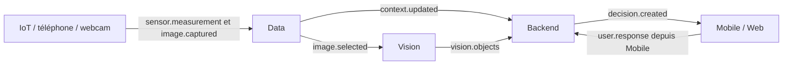

# Contrat d'interface JSON - LifeWise

Version : **0.1.0** · Rédigé le **25 novembre 2026** · Statut : **proposition à valider par les six référents**.

Ce contrat précise ce que chaque équipe reçoit et envoie. Il permet de développer les modules séparément, puis de les brancher ensemble.

Base de rédaction : *Document Data.pdf*, tâche 2.1, pages 1 et 2 ; contexte et agenda décrits dans les tâches 2.3 et 2.5. Les noms de messages, la structure détaillée et les règles techniques ci-dessous sont des propositions d'implémentation. Aucun accord des équipes n'est présumé.

## 1. Les sept échanges



| Type exact du message | Émetteur | Destinataire | Contenu |
| --- | --- | --- | --- |
| `sensor.measurement` | IoT | Data | Une mesure de porte, mouvement ou luminosité. |
| `image.captured` | IoT / téléphone / webcam | Data | Une image brute et sa provenance. |
| `image.selected` | Data | Vision | Une image exploitable après prétraitement. |
| `vision.objects` | Vision | Backend | Les objets détectés et leurs scores de confiance. |
| `context.updated` | Data | Backend | Mesures récentes, qualité des données et agenda. |
| `decision.created` | Backend | Mobile et Web | Décision d'alerte, message et justification. |
| `user.response` | Mobile | Backend | Réponse `remind_5min` ou `ignore` à une alerte. |

Le contrat décrit les données, indépendamment du transport. HTTP, MQTT, les routes et le stockage partagé doivent être convenus avec les équipes ; ils ne sont pas imposés ici.

## 2. Règles communes

Chaque message est un objet JSON encodé en UTF-8, sans commentaire.

| Champ | Type | Obligatoire | Signification |
| --- | --- | --- | --- |
| `schema_version` | texte | Oui | Version du contrat : `0.1.0`. |
| `id` | texte non vide | Oui | Identifiant unique de ce message. Utiliser un UUID en production ; les exemples utilisent des noms lisibles. |
| `type` | texte | Oui | L'un des sept types ci-dessus. |
| `timestamp` | date UTC | Oui | Instant de création du message, au format ISO 8601 : `2026-11-27T08:31:05Z`. |
| `source` | texte | Oui | Origine de la donnée, selon les valeurs précisées pour chaque message. |
| `event_id` | texte non vide | Selon le message | Identifiant du même événement de départ, conservé pendant toute la chaîne. |
| `scenario_id` | texte non vide | Non | Identifiant du scénario de test ; à conserver dans les messages qui en dérivent. |

- Les dates se terminent par `Z` et utilisent UTC. `timestamp` désigne l'émission ; `measured_at` et `captured_at` gardent l'instant réel de mesure ou de capture.
- `event_id` est facultatif sur les mesures et captures brutes, qui peuvent précéder un départ. Data attribue l'événement lorsqu'il regroupe les données autour d'un départ potentiel, même si aucune image n'est exploitable. Il est obligatoire pour les cinq autres types de messages. Un simulateur peut le fournir dès l'entrée.
- Une nouvelle émission reçoit un nouvel `id`. Une retransmission du même message conserve son `id` et son contenu ; le destinataire ne doit pas appliquer deux fois ses effets.
- Pour `image.captured`, `image.selected` et `vision.objects`, `source` est toujours la caméra d'origine : **`raspberry`, `phone` ou `webcam`**. Elle est conservée même après traitement par Data ou Vision. Le type indique le module émetteur. Le champ `image_source` de l'exemple du sujet est ici uniformisé sous le nom `source`.
- Les objets étudiés sont nommés **`phone`, `keys`, `wallet`**. Les valeurs JSON restent en anglais ; les messages destinés à l'utilisateur peuvent être en français.
- Une information inconnue ne doit pas être inventée. Les champs facultatifs sont omis ; `null` n'est accepté que lorsqu'il est explicitement autorisé.
- Les chemins d'image sont relatifs à une racine de stockage partagée, avec `/`. Le fichier est transmis ou rendu accessible séparément : son contenu binaire n'est pas placé dans le JSON.

## 3. Détail des messages

Les exemples ci-dessous appartiennent au même événement `evt_0042`. Les chemins et identifiants sont fictifs. Le fichier [chaine-complete.json](../02-data/documents/exemples/chaine-complete.json) regroupe la chaîne et ajoute les mesures de mouvement et de luminosité. Tous les champs spécifiques décrits dans les tableaux sont obligatoires ; les exceptions concernant les champs communs restent celles de la section 2.

### 3.1. Mesure capteur : `sensor.measurement`

**IoT vers Data.** Un message transporte une mesure, ce qui permet aux capteurs d'émettre à des moments différents.

| Champ spécifique | Type | Règle |
| --- | --- | --- |
| `source` | texte | `raspberry` ou `simulator`. |
| `sensor` | texte | `door`, `motion` ou `luminosity`. |
| `value` | texte / booléen / nombre | Porte : `open` ou `closed` ; mouvement : `true` ou `false` ; luminosité : nombre supérieur ou égal à 0. |
| `unit` | texte ou `null` | `lux` pour la luminosité ; `null` pour les deux autres capteurs. |
| `measured_at` | date UTC | Instant de la mesure. |

```json
{
  "schema_version": "0.1.0",
  "id": "msg_mesure_porte",
  "type": "sensor.measurement",
  "timestamp": "2026-11-27T08:31:05Z",
  "source": "raspberry",
  "event_id": "evt_0042",
  "sensor": "door",
  "value": "open",
  "unit": null,
  "measured_at": "2026-11-27T08:31:05Z"
}
```

Un capteur indisponible n'envoie pas de fausse valeur `0` ou `false`. Data signale son indisponibilité dans le contexte. L'unité `lux` est une proposition à confirmer avec IoT ; une valeur brute de capteur ne doit pas être présentée comme des lux sans conversion.

### 3.2. Image capturée : `image.captured`

**IoT / téléphone / webcam vers Data.** Décrit l'image avant prétraitement.

| Champ spécifique | Type | Règle |
| --- | --- | --- |
| `source` | texte | `raspberry`, `phone` ou `webcam`. |
| `image_id` | texte non vide | Identifiant unique de l'image brute. |
| `image_path` | texte non vide | Chemin partagé du fichier brut. |
| `captured_at` | date UTC | Instant réel de capture. |
| `content_type` | texte | `image/jpeg` ou `image/png`. |
| `width`, `height` | entiers positifs | Dimensions en pixels. |

```json
{
  "schema_version": "0.1.0",
  "id": "msg_image_capturee",
  "type": "image.captured",
  "timestamp": "2026-11-27T08:31:05Z",
  "source": "phone",
  "event_id": "evt_0042",
  "image_id": "img_0042_raw",
  "image_path": "02-data/donnees/phone_jour_007.jpg",
  "captured_at": "2026-11-27T08:31:05Z",
  "content_type": "image/jpeg",
  "width": 1280,
  "height": 960
}
```

### 3.3. Image sélectionnée : `image.selected`

**Data vers Vision.** Seules les images exploitables sont envoyées à Vision.

| Champ spécifique | Type | Règle |
| --- | --- | --- |
| `event_id` | texte non vide | Obligatoire à partir de ce message. |
| `source` | texte | Caméra d'origine, conservée depuis la capture. |
| `image_id` | texte non vide | Identifiant de la version prétraitée. |
| `original_image_id` | texte non vide | Référence à l'image brute. |
| `image_path`, `captured_at`, `width`, `height` | comme ci-dessus | Fichier traité et dimensions après traitement ; date de capture conservée. |
| `content_type` | texte | `image/jpeg` ; image convertie en RGB. |
| `quality` | objet | `usable` vaut `true` ; `blur_score` est la variance du Laplacien, positive ou nulle ; `brightness` est la moyenne en niveaux de gris, entre 0 et 255. |

```json
{
  "schema_version": "0.1.0",
  "id": "msg_image_selectionnee",
  "type": "image.selected",
  "timestamp": "2026-11-27T08:31:06Z",
  "source": "phone",
  "event_id": "evt_0042",
  "image_id": "img_0042_selected",
  "original_image_id": "img_0042_raw",
  "image_path": "02-data/donnees/pretraitees/phone_jour_007.jpg",
  "captured_at": "2026-11-27T08:31:05Z",
  "content_type": "image/jpeg",
  "width": 640,
  "height": 480,
  "quality": {
    "usable": true,
    "blur_score": 142.7,
    "brightness": 118.2
  }
}
```

La largeur de 640 pixels est proposée pour le pilote. Les seuils de flou et de luminosité doivent être calibrés sur les photos de S1 avec Vision. Si aucune image ne passe, Data n'émet pas `image.selected` et transmet un contexte avec `image_usable: false`, `selected_image_id: null` et les motifs de rejet.

### 3.4. Objets vus : `vision.objects`

**Vision vers Backend.** La Vision décrit ses détections ; la décision d'oubli appartient au Backend.

| Champ spécifique | Type | Règle |
| --- | --- | --- |
| `source` | texte | Caméra d'origine de l'image sélectionnée. |
| `image_id` | texte non vide | Référence à l'image sélectionnée. |
| `objects_seen` | liste d'objets | Chaque élément contient `label` (`phone`, `keys`, `wallet`) et `confidence` (nombre entre 0 et 1 inclus). |

```json
{
  "schema_version": "0.1.0",
  "id": "msg_objets_vus",
  "type": "vision.objects",
  "timestamp": "2026-11-27T08:31:07Z",
  "source": "phone",
  "event_id": "evt_0042",
  "image_id": "img_0042_selected",
  "objects_seen": [
    {"label": "phone", "confidence": 0.93},
    {"label": "keys", "confidence": 0.81}
  ]
}
```

Une liste vide signifie « aucun objet cible détecté sur cette image exploitable ». Elle ne remplace pas une erreur de Vision et ne prouve pas, seule, l'absence physique des objets. L'adaptateur Vision filtre les autres catégories et garde un seul résultat par label, avec le score maximal. Aucun champ `alert`, `missing_objects` ou phrase « portefeuille oublié » n'est envoyé par Vision.

### 3.5. Contexte : `context.updated`

**Data vers Backend.** Regroupe les informations autres que les détections pour le même événement.

| Champ spécifique | Type | Règle |
| --- | --- | --- |
| `source` | texte | `data`. |
| `measurements` | liste d'objets | Au plus une mesure récente exploitable par capteur : `measurement_id`, `source`, `sensor`, `value`, `unit`, `measured_at`. Les types de valeur et d'unité sont ceux de 3.1. |
| `quality.sensors_available` | objet | Trois booléens : `door`, `motion`, `luminosity`. `true` signifie qu'une mesure exploitable de ce capteur est incluse ; sinon `false`. |
| `quality.measurement_max_age_seconds` | entier positif | Âge maximal utilisé par Data pour sélectionner les mesures, relativement au `timestamp` du contexte. Proposition du pilote : 30 secondes. |
| `quality.image_usable` | booléen | Une image sélectionnée exploitable est disponible. |
| `quality.selected_image_id` | texte ou `null` | Identifiant de cette image ; `null` si aucune image exploitable. |
| `quality.rejected_images` | liste d'objets | Chaque rejet contient `image_id`, `source` et `reasons`, liste non vide parmi `blurred`, `too_dark`, `invalid_image`. |
| `agenda` | liste d'objets | Chaque rendez-vous contient `id`, `title`, `start` (date UTC) et `location` (texte ou `null`). Liste vide si aucun rendez-vous connu. |

```json
{
  "schema_version": "0.1.0",
  "id": "msg_contexte",
  "type": "context.updated",
  "timestamp": "2026-11-27T08:31:07Z",
  "source": "data",
  "event_id": "evt_0042",
  "measurements": [
    {"measurement_id": "msg_mesure_porte", "source": "raspberry", "sensor": "door", "value": "open", "unit": null, "measured_at": "2026-11-27T08:31:05Z"},
    {"measurement_id": "msg_mesure_mouvement", "source": "raspberry", "sensor": "motion", "value": true, "unit": null, "measured_at": "2026-11-27T08:31:05Z"},
    {"measurement_id": "msg_mesure_luminosite", "source": "raspberry", "sensor": "luminosity", "value": 180, "unit": "lux", "measured_at": "2026-11-27T08:31:05Z"}
  ],
  "quality": {
    "sensors_available": {"door": true, "motion": true, "luminosity": true},
    "measurement_max_age_seconds": 30,
    "image_usable": true,
    "selected_image_id": "img_0042_selected",
    "rejected_images": []
  },
  "agenda": [
    {"id": "rdv_01", "title": "Réunion", "start": "2026-11-27T08:45:00Z", "location": "bureau"}
  ]
}
```

Ne pas mélanger les détections d'un événement avec le contexte d'un autre. Le Backend peut recevoir le contexte et les détections dans n'importe quel ordre ; il les rapproche par `event_id` et par l'image sélectionnée. Le pilote propose une seule image sélectionnée par événement ; un traitement multicaméra simultané demandera une évolution concertée.

### 3.6. Décision : `decision.created`

**Backend vers Mobile et Web.** Le Backend applique ses règles et conserve les références permettant d'expliquer sa décision.

| Champ spécifique | Type | Règle |
| --- | --- | --- |
| `source` | texte | `backend`. |
| `context_id` | texte non vide | `id` du contexte utilisé. |
| `observation_ids` | liste de textes | `id` des messages `vision.objects` utilisés. Au moins un pour une alerte. |
| `status` | texte | `evaluated` si la décision a pu être prise ; `insufficient_data` si les données nécessaires manquent. |
| `alert` | booléen | `true` pour demander l'affichage d'une alerte ; `false` sinon. |
| `missing_objects` | liste de labels | Objets signalés dans l'alerte. Liste non vide si `alert: true`, vide sinon. Aucun doublon. |
| `message` | texte non vide | Texte affichable à l'utilisateur. |
| `justification` | texte non vide | Explication de la décision ou des données insuffisantes. |

```json
{
  "schema_version": "0.1.0",
  "id": "msg_decision",
  "type": "decision.created",
  "timestamp": "2026-11-27T08:31:08Z",
  "source": "backend",
  "event_id": "evt_0042",
  "context_id": "msg_contexte",
  "observation_ids": ["msg_objets_vus"],
  "status": "evaluated",
  "alert": true,
  "missing_objects": ["wallet"],
  "message": "Pensez à vérifier votre portefeuille avant de partir.",
  "justification": "La porte est ouverte, un mouvement est détecté, le portefeuille attendu n'est pas détecté sur l'image exploitable et une réunion est prévue à 08:45 UTC."
}
```

Cet exemple suppose que la configuration du Backend attend `phone`, `keys`, `wallet` et considère le rendez-vous dans 14 minutes comme proche. Il illustre un échange ; les règles de départ, les objets habituels, le seuil de confiance et la fenêtre d'agenda doivent être validés avec Backend.

Sans alerte, Mobile et Web peuvent afficher la décision dans l'historique sans notification d'oubli. Avec `status: insufficient_data`, `alert` est obligatoirement `false` et `missing_objects` est vide. Une erreur de Vision ou une image rejetée ne devient jamais artificiellement une liste d'objets absents.

### 3.7. Réponse utilisateur : `user.response`

**Mobile vers Backend.** La réponse référence précisément l'alerte affichée.

| Champ spécifique | Type | Règle |
| --- | --- | --- |
| `source` | texte | `mobile`. |
| `decision_id` | texte non vide | `id` d'une décision du même événement ayant `alert: true`. |
| `action` | texte | Exactement `remind_5min` ou `ignore`. |

```json
{
  "schema_version": "0.1.0",
  "id": "msg_reponse",
  "type": "user.response",
  "timestamp": "2026-11-27T08:31:10Z",
  "source": "mobile",
  "event_id": "evt_0042",
  "decision_id": "msg_decision",
  "action": "remind_5min"
}
```

`remind_5min` demande un rappel cinq minutes après le `timestamp` de la réponse, soit `08:36:10Z` ici. `ignore` ferme cette alerte sans programmer de rappel. Une retransmission du même `id` ne doit pas créer un deuxième rappel. Ces effets sont à implémenter par Backend ; ce livrable définit uniquement leur interface.

## 4. Validation des messages et gestion des erreurs

Le fichier [contrat-interface.schema.json](../02-data/documents/schemas/contrat-interface.schema.json) est le schéma JSON Schema 2020-12 de cette proposition. Il valide **un message**. Le tableau JSON d'exemples est une fixture : valider séparément chacun de ses neuf messages, avec la vérification des formats de date activée. La commande de vérification figure dans le [dossier Data](../02-data/documents/README.md).

Le schéma vérifie les champs obligatoires, les types, les sources, les valeurs autorisées, les bornes de confiance et les principales règles conditionnelles. Il refuse les champs inconnus pour éviter les fautes de nom et les ajouts silencieux.

Les modules vérifient aussi ce que le schéma seul ne peut pas garantir :

- unicité des `id` et cohérence d'une retransmission ;
- existence des fichiers et correspondance du format et des dimensions annoncés ;
- références existantes, même `event_id` et même caméra dans la chaîne d'image ;
- concordance entre chaque mesure du contexte et son message d'origine, une mesure au plus par capteur, disponibilité et âge compris entre 0 et `measurement_max_age_seconds` ;
- un seul résultat par label dans `objects_seen` ;
- correspondance de l'image des observations avec `quality.selected_image_id` et absence d'alerte d'oubli fondée sur une image inutilisable ;
- une réponse utilisateur attachée à une décision d'alerte existante du même événement.

Un message non conforme est refusé et son `id`, son `type` et la raison sont journalisés quand ils sont lisibles. Il n'est pas transformé en détection vide ou en valeur capteur par défaut. La forme de l'erreur renvoyée dépendra du transport choisi.

Si Vision échoue ou ne répond pas, Backend ne considère pas ce silence comme une absence d'objets. La proposition est d'attendre au plus cinq secondes après le contexte ; sans observation requise à l'échéance, enregistrer `insufficient_data` et aucune alerte d'oubli. Cette durée et le signal d'erreur du transport restent à confirmer avec Vision et Backend.

## 5. Validation par les six référents

Objectif du sujet : validation avant la fin de S1, le **30 novembre 2026**. Toutes les lignes sont en attente ; le document n'est pas encore un contrat approuvé.

| Équipe | Référent | Ce qu'il faut confirmer | Accord / date |
| --- | --- | --- | --- |
| Data | Michel Sagesse Kolie | Prétraitement, contexte, stockage partagé et cohérence des références. | En attente |
| IoT | Adila Yassir | Mesures, unité de luminosité, capture et horodatage. | En attente |
| Vision | Bachirou Konate | Format d'image, labels, scores et erreurs de traitement. | En attente |
| Backend | Adnane Qassiri | Contexte, règles d'alerte, délais, décisions et actions utilisateur. | En attente |
| Web | Saïd Jadli | Lecture des décisions et affichage de l'historique. | En attente |
| Mobile | Karamo Sylla | Notifications et réponses `remind_5min` / `ignore`. | En attente |

Les noms et rôles proviennent du [README du dépôt](../README.md) et des [missions des équipes](equipes/). Leur présence dans ce tableau ne vaut pas approbation du contrat.

Préparer une réunion de 15 à 20 minutes avec un représentant de chaque équipe : demander à chacun « Que reçoit ton module ? » et « Que produit-il, et pour qui ? », parcourir les sept exemples, trancher les propositions ouvertes et remplir les six accords.

Points techniques proposés à confirmer ensemble : transport et accès aux fichiers, luminosité en lux, JPEG/RGB et largeur 640 pixels, ancienneté maximale des mesures de 30 secondes, une image par événement, délai de cinq secondes et paramètres des règles Backend. Les données simulées utilisent les mêmes formats et conservent la caméra qu'elles représentent.

## 6. Modifications après validation

1. Toute modification passe par une pull request indiquant le besoin, les champs concernés et les équipes touchées.
2. Les équipes qui émettent et reçoivent les messages concernés relisent la modification avant fusion.
3. Mettre à jour ensemble ce document, le schéma et les exemples. Avec la validation stricte, même un champ ajouté exige une revue de compatibilité.
4. Si le format accepté change, attribuer une nouvelle `schema_version` et prévoir la migration coordonnée des producteurs et consommateurs. Ne pas modifier silencieusement la signification d'une version existante.
5. Conserver les accords des six référents pour la version initiale et les décisions de revue des versions suivantes dans le dépôt.
